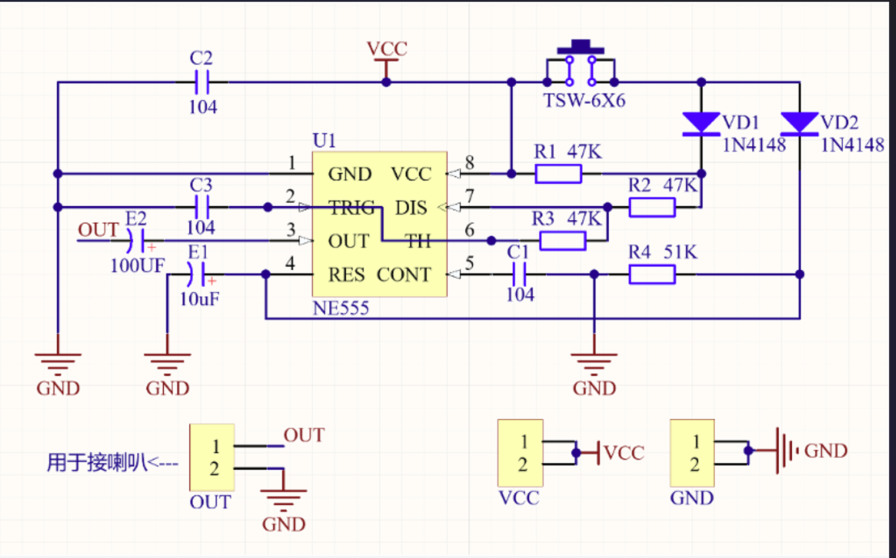
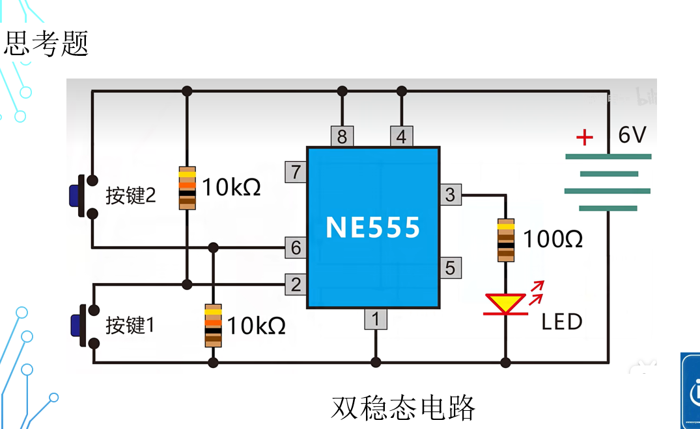
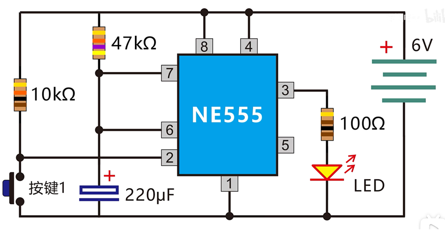
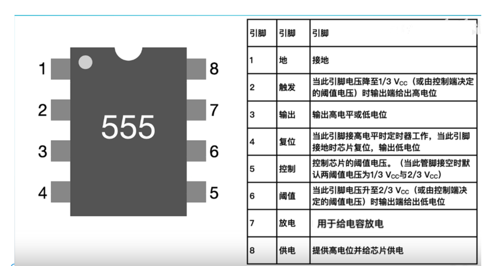
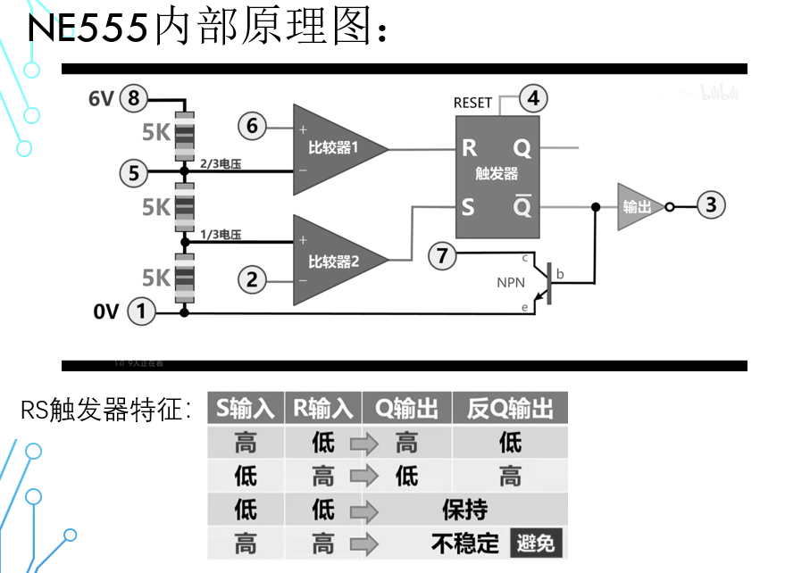

# NE555

## 1.叮咚电路

- ####未按下按键：4接地，E1无电；NE555复位，3为0，喇叭无声；

- #### 按下按键：4为高电平；VCC通过（按键 VD1 R1并联）R2 R3 到c3；3输出高电平；vcc 通过VD2 .R4.向E1充电和4；C3 R2R3震荡，喇叭频率高（与下一步相比）；

- #### 松开按键：E1通过R4放电，4仍然为高电平；Vcc通过R1 R2 R3 到C3；震荡网络总电阻变大，频率变低；E1放完电，4接地，NE555复位，喇叭无声

- #### 按下按键：······

  原理简介:

开关未按下时,NE555的4脚通过R4接地,IC处于复位状态,3脚输出低电平,扬声器无

当按下KEY时,VCC通过D1向R2、R3、C3振荡网络提供工作电压,此时R1与KEY和D1呈
并联电路,使总电阻变小,555振荡频率变高,产生叮声。
当松开KEY时,由于E1上的电荷通过R4放电,使555的4脚仍为高电平,555仍将维持振
荡状态,此时由R1,R2,R3,C3等组成的网络使振荡频率变低,产生咚声。随着E1逐渐放电,
直到5554脚为低电平的时候,555再次复位,停止振荡,扬声器无声。
再次按下KEY时,将重复上述步骤.

## 2.双稳态电路

- #### 按下按键1：2与负极接通，0v<1/3Vcc,S为1，Q为1，3输出高电平，LED亮

- #### 按下按键2：6与正极接通，6v>2/3Vcc,R为1，Q为0，3输出低电平，LED熄灭

- #### 未按下按键时，2 6悬空，很不稳定，给按键1一个上拉电阻，使2与正极连；给按键2一个下拉电阻，使6与负极相连

- #### 100欧电阻的作用，3可以输出200mA的大电流，为了保护LED,串联一个电阻；

## 3.单稳态电路

  

- #### 刚接电源：7与负极接通，6 7相连为0V，电容两端为低电平，相当于短接，电容无电

- #### 按下按键：2为0V,S<1/3Vcc,Q为1，3为1，输出高电平，三极管截至，电容充电；当6>2/3Vcc,Q为0，3输出低电平，三极管导通，电容放电

## 4.引脚

- #### 2:-->S; 6:--->R;3--->输出；1--->接地；8--->Vcc;4--->复位；7--->三极管通断接地与否

## 5

- 

